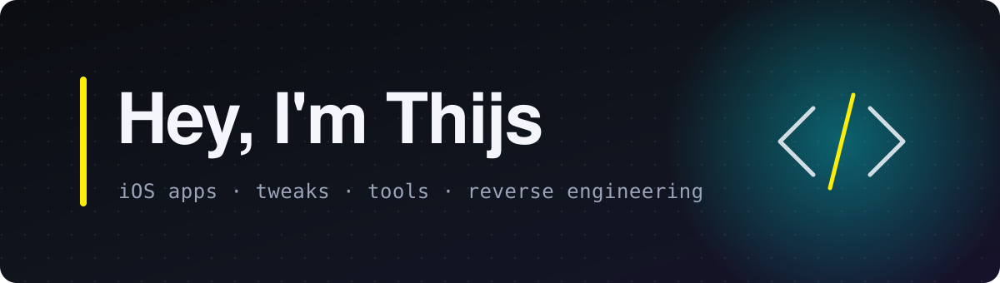

  

I'm Thijs. I make iOS apps, jailbreak tweaks and developer tools, and I like taking software apart to see how it works.
Most of what I build lives somewhere between SwiftUI, Metal and low-level patching: polished interfaces on top, and
whatever it takes underneath to make things run where they normally wouldn't.

#### Projects

<table>
  <tr>
    <td width="64" align="center"></td>
    <td><a href="https://github.com/Thijs2004/CyPort"><b>CyPort</b></a> Runs your own copy of Cyberpunk 2077 for Mac natively on iPhone and iPad. A shim layer, binary patches, touch and controller support, cloud saves.</td>
  </tr>
  <tr>
    <td width="64" align="center"></td>
    <td><a href="https://github.com/Thijs2004/LiquidSiri"><b>LiquidSiri</b></a> A liquid glass Siri for jailbroken iOS, with a Swift + Metal glass orb and live wave visuals.</td>
  </tr>
  <tr>
    <td width="64" align="center"></td>
    <td><a href="https://github.com/Thijs2004/nxnative-mkw"><b>nxnative-mkw</b></a> Mario Kart World on iPhone and Mac, built on nxnative. Bring your own dump.</td>
  </tr>
</table>

#### Right now

Making CyPort run cooler and smoother on iPhone, and working on a few apps that aren't public yet.

#### Tools I use

