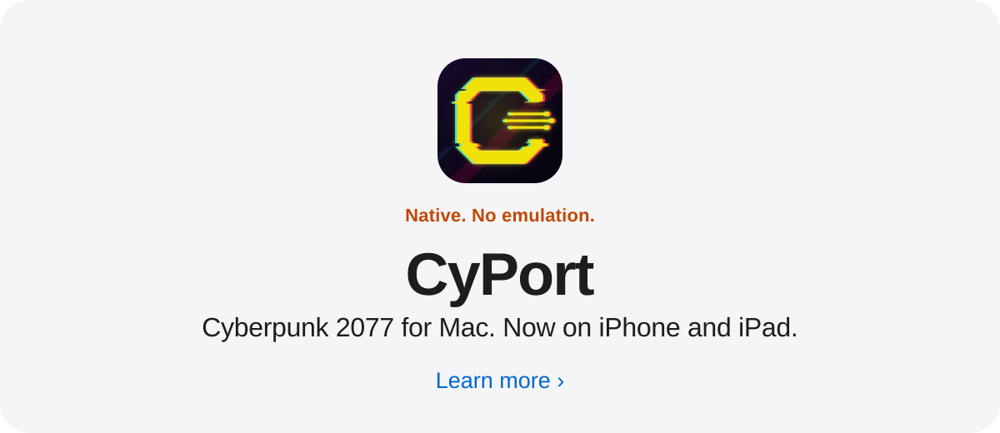
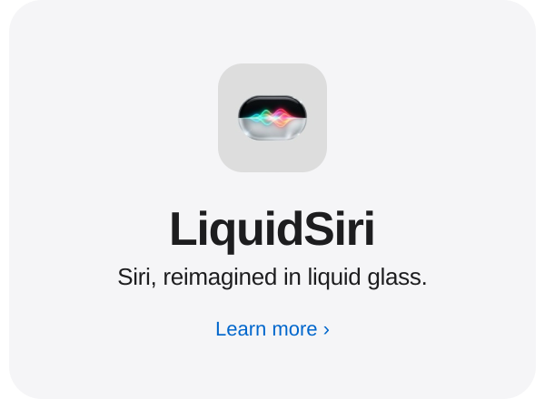
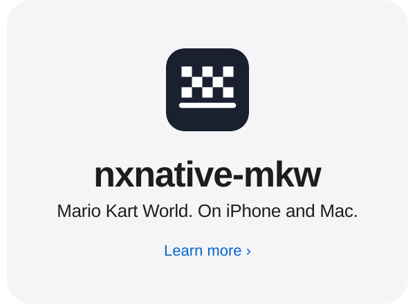

  <picture>
    <source media="(prefers-color-scheme: dark)" srcset="assets/hello-dark.svg" />
    
  </picture>

 

  <a href="https://github.com/Thijs2004/CyPort">
    <picture>
      <source media="(prefers-color-scheme: dark)" srcset="assets/cyport-dark.svg" />
      
    </picture>
  </a>

<a href="https://github.com/Thijs2004/LiquidSiri"><picture><source media="(prefers-color-scheme: dark)" srcset="assets/tile-liquidsiri-dark.svg" /></picture></a><a href="https://github.com/Thijs2004/nxnative-mkw"><picture><source media="(prefers-color-scheme: dark)" srcset="assets/tile-mkw-dark.svg" /></picture></a>

 

  Swift · SwiftUI · Metal · Objective-C · C · C++ · Python

