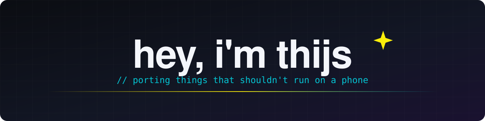

  

I'm Thijs. I make iOS apps, jailbreak tweaks and developer tools, and I like taking software apart to see how it works.
Most of what I build lives somewhere between SwiftUI, Metal and low-level patching: polished interfaces on top, and
whatever it takes underneath to make things run where they normally wouldn't.

#### Projects

| | | |
|:-:|---|---|
|  | **[CyPort](https://github.com/Thijs2004/CyPort)** | Runs your own copy of Cyberpunk 2077 for Mac natively on iPhone and iPad. A shim layer, binary patches, touch and controller support, cloud saves. |
|  | **[LiquidSiri](https://github.com/Thijs2004/LiquidSiri)** | A liquid glass Siri for jailbroken iOS, with a Swift + Metal glass orb and live wave visuals. |
|  | **[nxnative-mkw](https://github.com/Thijs2004/nxnative-mkw)** | Mario Kart World on iPhone and Mac, built on nxnative. Bring your own dump. |

#### Right now

Making CyPort run cooler and smoother on iPhone, and working on a few apps that aren't public yet.

#### Tools I use

